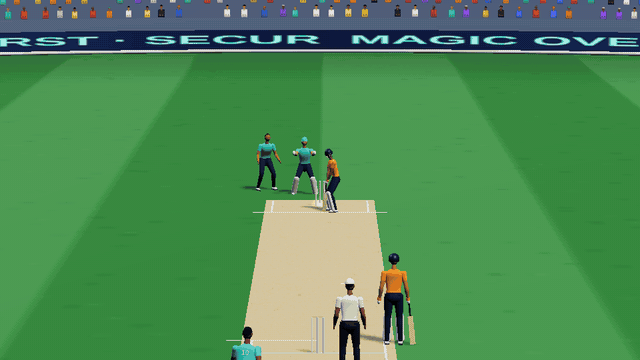
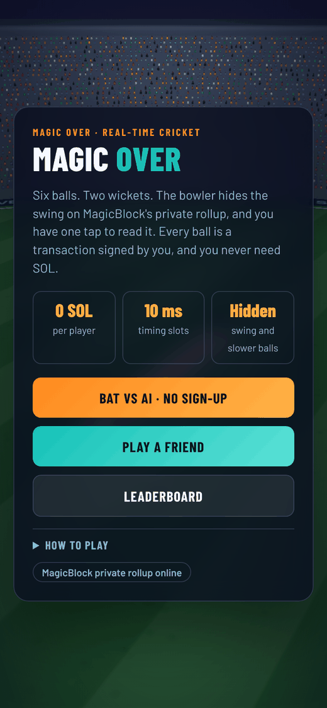
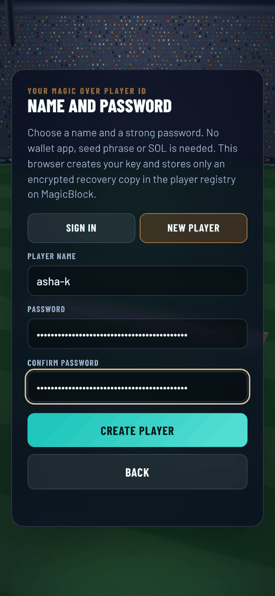
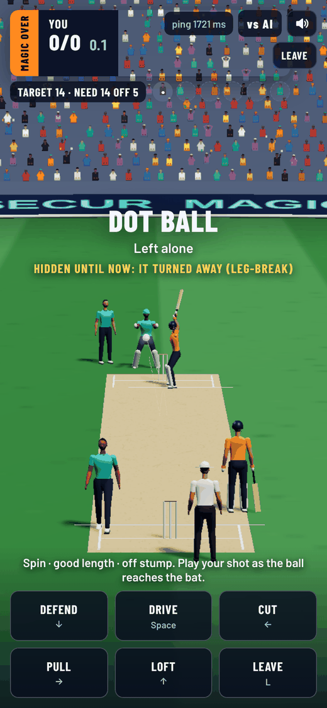

# Magic Over

Magic Over shows that a Web2 player can start using a Solana app with just a player name and a passphrase. There is no wallet app to install, no seed phrase to write down and no SOL to buy. On another device, the same name and passphrase bring the same player back.

The sign-up is called **Smaran**, Sanskrit for remembering: all a player needs is to remember a name and a passphrase. It is also packaged for other web apps, as a sign-in window they open or as one file they load, where a Magic Over player signs in with the same name, passphrase and key: see [Smaran](smaran/).

Smaran is built to outlive the app: the login is saved on Solana, not on any login server, the page is open source, and anyone can refill the registry's save reserves when they run low, so players can still sign in if we stop. Smaran's guide says [what it still depends on](smaran/README.md#what-smaran-is-and-what-it-is-not).

To show this working in a real-time app, it comes with a 3D cricket game on MagicBlock's Ephemeral Rollups, running on Solana Devnet.

[Play it](https://ch4itu.github.io/MagicOver/) · [Onboarding demo, 37 s](https://ch4itu.github.io/MagicOver/media/onboarding.mp4) · [Pitch and gameplay](https://cdn.jsdelivr.net/gh/ch4itu/MagicOver@main/media/pitch.mp4)

Smaran also signs players into [EternalBliss](eternalbliss/), an RPG in this repository whose shared worlds and duels run on MagicBlock's public Ephemeral Rollup, like Smaran's registry, and into [Ludo Freeflow](https://ch4itu.github.io/MagicOver/ludo-freeflow/), four-colour Ludo with no turns whose online matches roll MagicBlock VRF dice on the rollup.

  
  
  

Top: two deliveries drawn by the game's own 3D scene. Below: the home screen, sign-up and a Bat vs AI match on the live site, at phone size. The ping is high because these were taken on a test machine far from the rollup.

## How sign-up works

1. The player picks a name (3 to 32 characters: a to z, 0 to 9, `_` or `-`) and a passphrase of at least 16 characters.
2. The browser creates a random signing key. The key does not come from the passphrase.
3. The browser locks a copy of the key with the passphrase. Argon2id (64 MiB, three passes) turns the passphrase into a wrapping key, and XChaCha20-Poly1305 encrypts the key. The locked copy is tied to the player name, the player's public key and the network.
4. After a small anti-bot proof of work, which the program checks, the browser registers three things in the player registry on MagicBlock's public Ephemeral Rollup: a hash of the name, the public key and the locked copy. The player signs this transaction with 0 SOL.
5. The page then asks the rollup to save the registry back to Solana Devnet. Sign-up does not wait for that confirmation.

**On another device**, the same name and passphrase are enough. The browser reads the locked copy from the rollup, or the last copy saved on Solana, unlocks it locally and checks that the key matches the registered public key.

The passphrase never leaves the browser, there is no login server, and the unlocked key is kept only in memory. There is no passphrase reset: if the passphrase is lost, so is the player ID. A player who still knows the passphrase can change it on the [Smaran page](https://ch4itu.github.io/MagicOver/smaran/); the player key stays the same.

**Guests** can skip all of this. Games against the AI use a temporary key made in the browser.

**Why players need no SOL:** the registry and the match tables were created and paid for once, then delegated to MagicBlock's rollups. Sign-up and every move in a match are rollup transactions that the player signs at no cost.

## The game

Each side bats one over of six balls, with two wickets.

- **Bowling:** the bowler picks pace, line and length, which the batter can see, plus a hidden variation: swing, spin or a slower ball.
- **Batting:** the batter taps a shot as the ball arrives: defend, drive, cut, pull, loft or leave.
- **Result:** the chasing side needs one more run than the first innings. A tie goes to a Super Over, one more over each, up to three times. If the scores are still level, the match is tied.

The program judges shot timing on the rollup in 10 ms slots: perfect within ±60 ms, good within ±130 ms and an edge within ±240 ms. These are scoring windows on the rollup, not a promise of 10 ms end-to-end latency. Network delay still affects the player.

Ways to play:

- **Bat vs AI** (no sign-up): chase a target of 3 to 8 runs set by MagicBlock VRF, which also picks the AI's deliveries.
- **Full match vs AI** (no sign-up): bat an over against the AI, then bowl one at it, as in a friend match. VRF picks the AI's deliveries and its shots. The AI sees pace, line and length like any batter, never your hidden variation.
- **Play a friend** (needs a player ID): create a match and share its code, or join an open one.
- **Watch** (no sign-up): follow any live match from the home screen. The watching page only reads the table and sends nothing. It sees what the batter sees, so the hidden variation stays hidden until the ball is played.

## How it uses MagicBlock

| Feature | Use in Magic Over |
| --- | --- |
| **Public ER** | Runs the delegated player registry, so players can register without any SOL. |
| **Private ER / PER** | Runs every match, against a friend or the AI: create, join, bowl, shot and resolution across eight reusable match tables. It also runs the friend leaderboard, which reads each finished result straight from its match table, so players record results without any SOL. |
| **Private account permissions** | A separate ball account holds the hidden variation. Only a human bowler can read it: never the batter or a watcher, and nobody while the AI bowls. Pace, line and length are visible; the variation is revealed after the ball is resolved. |
| **VRF** | Picks the AI's target, its deliveries and, in a full match, its shots. The program checks the expected callback signer, table and sequence. The hidden variation also mixes in a private secret, so the VRF output alone does not reveal it. |
| **Zero-SOL player actions** | Player keys with no SOL sign every rollup move in the browser, with no wallet pop-ups. Sponsor costs still exist. |
| **Solana commits** | Registration asks for a registry save to Solana Devnet. Each newly recorded friend result asks for a save of the leaderboard totals. Match tables stay delegated so they can be reused quickly. |

The browser checks that it is talking to the expected MagicBlock validators. It does not verify a hardware attestation quote itself. The page bundles Solana web3.js for keys and addresses, and builds its transactions directly.

## Friend matches and the leaderboard

Create a match and share its code, or pick an open match from the lobby. After the result, both players can choose **Rematch with this friend**. The original host reopens the same table after its 15-second reset, and the friend joins that exact next match.

The **shared leaderboard** keeps recorded totals by player key in a separate result register, so reusing a match table does not erase them. A win is worth 3 points and a draw 1. It also adds up each player's runs off the bat, fours, sixes and wickets taken, Super Overs included, for friend matches from 7 November 2026; earlier results count only for wins, losses and draws. AI practice is separate. Completed forfeits count, and a result recorded twice counts once.

The leaderboard refreshes every five seconds while it is open and catches up when the player returns to the tab. It shows whether totals are saved on Solana. The page tries to save a finished friend result before reusing its table.

## Programs on Solana Devnet

| Program | Explorer |
| --- | --- |
| Cricket game | [`HwXp4A62RG3nBkmxTTaHbSi1wNj8vaVqZ6Kn5VkYBswT`](https://explorer.solana.com/address/HwXp4A62RG3nBkmxTTaHbSi1wNj8vaVqZ6Kn5VkYBswT?cluster=devnet) |
| Player registry | [`CW9AQnTKvTnBfsdUChQiYKfCPhWb7FWkUWyVxv1iaN5P`](https://explorer.solana.com/address/CW9AQnTKvTnBfsdUChQiYKfCPhWb7FWkUWyVxv1iaN5P?cluster=devnet) |
| Result register | [`BcS2Gb1Gihfzqs1UkViNnbQzjGcCGyvXu81VhwsFrUzU`](https://explorer.solana.com/address/BcS2Gb1Gihfzqs1UkViNnbQzjGcCGyvXu81VhwsFrUzU?cluster=devnet) |
| EternalBliss worlds, character books and duels | [`6e5ied8gFYVSEoc6wWGwBwVSFAC9DZNYAgKg53M1rGdb`](https://explorer.solana.com/address/6e5ied8gFYVSEoc6wWGwBwVSFAC9DZNYAgKg53M1rGdb?cluster=devnet) |

## Files and building

- `index.html`: the whole game in one file. Open it in a modern browser with internet access, or serve it from any static host.
- `smaran/`: the sign-up for other apps: a sign-in window (`signin.html`, opened with `connect.js`) and one file (`smaran.js`, built from this page by `smaran/build.py`), with a [demo page](https://ch4itu.github.io/MagicOver/smaran/) and a short guide.
- `programs/`: source for the game, the player registry and the result register, with a shared pinned build setup.
- `ludo-freeflow/`: Ludo Freeflow in one file; its program is `programs/ludo`.
- `eternalbliss/`: EternalBliss in one file, with its program's source, checks and deployed build in `eternalbliss/program/` (its own pinned build setup).
- `media/onboarding.mp4`: 37-second recording on the live site. A player is created in one browser and recovered in a second browser with nothing saved.
- `media/pitch.mp4`: narrated, captioned pitch with desktop and mobile gameplay.
- `media/preview-*`: the pictures in these guides, taken from the live site on 5 and 6 November 2026.
- `LICENSE` and `THIRD_PARTY_NOTICES.md`: project and bundled dependency licences.

No package installation or login server is needed. The game talks directly to Solana and MagicBlock. To build the programs, use the pinned toolchain and `sbpf-linker 0.2.5`, then run `cargo build-bpf` from `programs/`.

## Limits

This is a Devnet prototype.

- **Registry size:** the player registry grows in capacity steps. Each group holds 35 names, because a program can create an account of at most 10,240 bytes in one instruction. Step 0 has 4 groups (140 names), and each later step doubles the groups: 8, 16, 32, 64 and 128, up to 8,820 names across six steps. A name goes into the first step that has room for it and never moves, so opening a step needs no program upgrade and no migration. The sponsor opens a step by creating its groups, at about 0.06 SOL per group including MagicBlock's deposit and a small save reserve. Steps 0 and 1 are open now, for 420 names.
- **Sign-up bots:** a small proof of work slows scripted sign-ups (about 1 second in a desktop browser, a few seconds on a phone), but it cannot stop a determined bot. Because capacity opens one paid step at a time, a flood can only fill the step that is open. Registry groups can only be delegated to the registry's MagicBlock validator. Only the registry admin can take a group with a healthy save reserve off the rollup; once a group's reserve falls below 0.001 SOL, anyone can (see Saves).
- **Leaderboard size:** the leaderboard holds 140 players, for the same account-size reason.
- **Match results:** there are eight match tables, reused between matches. Only recorded results persist, and a custom client can skip recording.
- **Saves:** MagicBlock refuses an account's 11th save to Solana in a delegation unless the account pays for its own saves. The registry groups and the leaderboard each pay from a small sponsor reserve: from the 26th save in a delegation, 0.0001 SOL per save. MagicBlock's session and save charges come out of the delegation deposit, never more than the deposit. A save needs a change to save, so empty saves cannot drain a reserve. Anyone can refill a registry group, without our key: once its reserve falls below 0.001 SOL (fewer than 10 paid saves left), anyone can take the group off the rollup, send it SOL on Solana and delegate it again, paying a new MagicBlock deposit of about 0.003 SOL. The leaderboard's reserve still needs the operator's key.
- **Passphrase:** there is no passphrase reset. The locked copy is public, so a weak passphrase can be guessed offline: Smaran is a login, not a wallet, and its accounts hold no money. The [Smaran guide](smaran/README.md) has the numbers and all the pros and cons.
- **Devnet:** Devnet itself may reset and erase test data.

Next: better cricket motion from real shot references, teams and player skins, clearer cameras, useful replays, stadium atmosphere and smooth mobile play. **No wagers, stakes, entry fees, tokens or prize payouts are included in the game.**

Project code: [MIT](LICENSE). Dependencies: [third-party notices](THIRD_PARTY_NOTICES.md).
