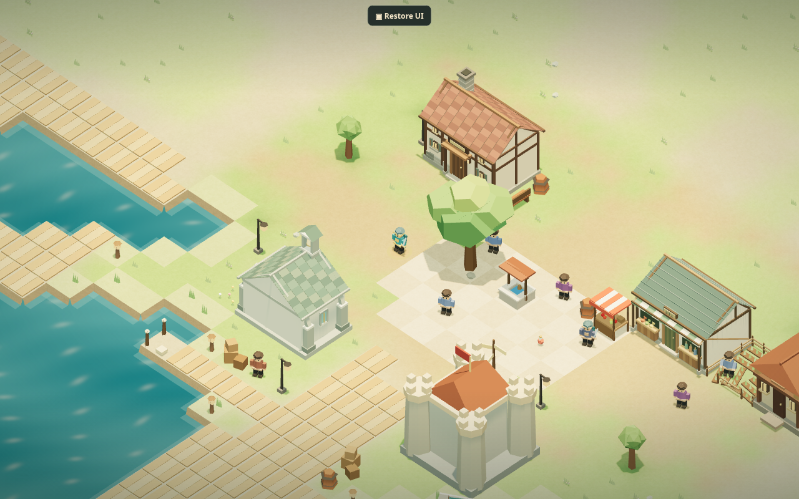

# EternalBliss overnight development report — 15/16 November 2026

Fifteen additional milestones are committed and pushed as **open draft PRs #9–#23**, stacked after the preserved PRs #5–#8. This is reviewable development work, not a merged or deployed release. Free play / non-intrusive-advertising-only policy is preserved; no monetization, chain writes, migrations or new runtime dependencies were implemented.

Latest feature: `feat/eternalbliss-hearthlight-chapel`, implementation commit `bd9677e`. Final HTML SHA-256: `f9faf30e118695aa3d93e1f058b0806978b250d58c6287a816fcc1575a61df08`. The final documentation commit does not change this tested HTML.

Live baseline `77b0b430995c9b37b9369bab1399ae5ec706ef80` and rollback `6321565231a81204e4c92c801ef3b9eca3175648` remain available. Remote main and its local tracking ref both remain `397a389d17a262b77084fc25c53e7a52566d803d`. All PRs #5–#23 were confirmed open drafts at handoff. No merges, deployments or pushes to main occurred.

## Milestones and evidence

Each PR is based on the previous feature branch. Review the stack from #5 upward; do not treat these as independent branches to merge in arbitrary order.

| Draft PR / implementation | Result | New focused evidence |
| --- | --- | --- |
| [#9](https://github.com/ch4itu/MagicOver/pull/9) · `1c460f3` | Portrait FP weapon fit and small impact feedback | 15 real WebGL blade-centre projections across five poses and desktop/portrait/landscape; new-candidate smoke. [Script](tests/weapon-frustum.cjs) |
| [#10](https://github.com/ch4itu/MagicOver/pull/10) · `f286a1f` | Crafted existing inn, pitched tiled roof, timber, supported threshold | Fixed noon/22:00 FP/overhead, actual entrance/exit and six blocked tiles; 28 cached batches / 4,338 vertices. [Evidence](tests/CRAFTED-INN.md) |
| [#11](https://github.com/ch4itu/MagicOver/pull/11) · `a96e1d2` | Soft ground transitions and connected orchard crowns | Zero seam delta at 1,534 desktop / 1,142 phone sampled mixed corners; authoritative state unchanged; canopy combat hide/restore. [Evidence](tests/LANDSCAPE.md) |
| [#12](https://github.com/ch4itu/MagicOver/pull/12) · `d3ae51c` | Tamsin's real scheduled herb work and three-parcel lesson | Actual choices, wrong-answer feedback, one potion once/reload, 44px targets, range/time/scope guards and affected Mira case. [Evidence](tests/VILLAGE-WORK.md) |
| [#13](https://github.com/ch4itu/MagicOver/pull/13) · `72896a9` | Climate-driven gradient/cloud/sun/moon/star atmosphere | Noon/dusk/night/phone-night shader/framebuffer checks; scope/reduced-motion/state checks; 325-vertex dome. [Evidence](tests/ATMOSPHERE.md) |
| [#14](https://github.com/ch4itu/MagicOver/pull/14) · `4e9c339` | Reachable FP archive gate/action priority and contextual hint | Reproduced distant Warden ray blocking nearby gate; desktop/phone actual gate, key once, vault route/combat/relic/exit/reload from explicit key fixture. [Evidence](tests/VAULT-USE.md) |
| [#15](https://github.com/ch4itu/MagicOver/pull/15) · `ae2a2a1` | Bram/Wren discovery-sensitive leads and persistent Atlas pins | Actual dialogue/buttons/tap, distinct destinations, no movement/discovery/reward, pin reload and stale/scope guards. [Evidence](tests/ROAD-LEADS.md) |
| [#16](https://github.com/ch4itu/MagicOver/pull/16) · `ff542ba` | Compact desktop FP card using existing Actions disclosure | 814×235 baseline becomes 330×156; short desktop 330×133; actual Atlas/minimize/restore and phone/overhead behavior. [Evidence](tests/FP-HUD.md) |
| [#17](https://github.com/ch4itu/MagicOver/pull/17) · `fb31cbc` | Crafted existing Exchange, saltbox roof, awning and wares | Fixed day/night FP/overhead, actual Use/Enter/Exit and footprint; 30 batches / 4,758 vertices; exact unaffected model digests. [Evidence](tests/CRAFTED-EXCHANGE.md) |
| [#18](https://github.com/ch4itu/MagicOver/pull/18) · `b21c1e3` | Natural Harvest Bell journey evidence | Fresh guest actual travel/introduction/key/entry/gate/combat, recorded-save resume, Bell/exit/return/reward once/reload; no injected progress or stats. [Evidence](tests/NATURAL-HARVEST.md) |
| [#19](https://github.com/ch4itu/MagicOver/pull/19) · `d567d70` | Full-height FP archive masonry, barrel vaults and warm fills | Desktop/phone wall/ceiling rays, state/cutaway/resources; actual gate/exit; final captures and smoke. [Evidence](tests/HARVEST-ARCHIVE.md) |
| [#20](https://github.com/ch4itu/MagicOver/pull/20) · `ac4911e` | Distance-driven solo hero/resident strides, soft settling | Node frame/time invariance and 72 identical old/new movement/heading frames; actual desktop keyboard, emulated touch, reduced motion and stable FP eye height. [Evidence](tests/DISTANCE-GAIT.md) |
| [#21](https://github.com/ch4itu/MagicOver/pull/21) · `bf22d8f` | Combat visibility with the new enclosure | 50 sampled foe anchors over five poses / two profiles; separate normal-renderer attack/reply/flee passes both profiles. [Evidence](tests/ENCLOSED-COMBAT.md) |
| [#22](https://github.com/ch4itu/MagicOver/pull/22) · `2c14067` | Existing archive rack readable, optional saved journal copy | Actual Use/tap/Space, reread, no reward/unlock, single copy/reload, range/scope guards; settled readable phone modal. [Evidence](tests/ARCHIVE-LEDGER.md) |
| [#23](https://github.com/ch4itu/MagicOver/pull/23) · `bd9677e` | Crafted north-facing Hearthlight Chapel | Fixed day/night FP/overhead, actual Use/blessing offer/Enter/Exit and six blocked tiles; 22 batches / 5,862 vertices; exact unaffected model digests; final smoke. [Evidence](tests/HEARTHLIGHT-CHAPEL.md) |

The inn, Exchange and chapel retain their existing plots, entrances and services. No buildings, residents or settlements were cloned. NPC work/rendering uses real local positions. All additions stay within the existing single-file application; tests and review artifacts are development-only.

## Screenshots

[Inn comparison](tests/review-images/crafted-inn-fp.jpg) · [Landscape comparison](tests/review-images/landscape-comparison.jpg) · [Atmosphere phases](tests/review-images/atmosphere-phases.jpg) · [Herb activity](tests/review-images/herb-work-phone.png) · [Resident leads](tests/review-images/resident-road-phone.png)

[Enclosed archive](tests/review-images/archive-after.png) · [Phone FP combat](tests/review-images/enclosed-combat-phone.png) · [Readable phone ledger](tests/review-images/archive-ledger-phone.png) · [Natural quest completion](tests/review-images/natural-harvest-complete.png)

## Test boundaries and retained failures

[Append-only ledger](tests/evidence.jsonl) records exact HTML/script hashes, profile, time and result. [Resume checkpoint](OVERNIGHT.md) maps every milestone. Raw logs, captures, historical script versions and the isolated natural guest storage checkpoint remain in `/workspace/.magic-over-setup/overnight-evidence`. No credentials or complete guest storage were committed.

Only relevant new checks and required new-candidate smoke checks ran. Unchanged passed contracts were reused for roof/detail/type-only corrections and documentation-only milestones. Historical 25/25 and 22/22 totals were not rerun or claimed as new independent passes. Final exact HTML has passing chapel geometry/cache, actual entrance/footprint/service-offer, fixed-camera day/night and 3D/FP/2D startup evidence; earlier unchanged gameplay evidence remains tied to its own source hashes.

The natural journey used actual controls and map inspection to plan travel. Its first run completed the Warden, then a harness action raced the three-second victory exit. The corrected harness resumed the actual recorded victory save rather than replaying completed travel/key/combat. This is a natural route across two executions, not an uninterrupted run or a staged key/relic fixture.

Two combined paused-pose/action checks missed an enemy reply; their cause was not proven. An instrumented run passed. Normal unpaused attack/reply/flee then passed desktop and phone without replaced action/timer functions. Pose rendering and action timing now have separate tests. The initial failures remain documented; paused capture is not timing evidence.

Other retained corrections include the first phone weapon inset, inn roof seams, old collapse-class/content-box HUD checks, frame-readiness and early animated modal captures, negative-zero assertions and phone culling assumptions. Their final evidence states what was corrected and what was reused. No failed candidate is labelled a pass.

## Remaining work and continuation

1. Physical Android performance, touch comfort and the previously reported long-frame movement jump remain unverified. Browser emulation and vertex/batch budgets are not hardware FPS evidence.
2. Live two-client shared-world behavior remains unverified. Source isolation and stubbed guards are not live multiplayer tests; no chain writes were authorized.
3. A final release candidate still needs the required once-per-candidate regression matrix and visual review before any merge/deployment. No release candidate was nominated here.
4. The Alerith reference was unavailable; these are original bounded craft improvements, with no reference-fidelity claim. Further architecture should continue one existing asset at a time; the Surveyors' Hall/cottage and remaining foreground occlusion are reasonable next targets after reviewing this stack.
5. Reuse the completed ledger/checkpoint on resume. Do not restart the natural journey or passed unchanged suites merely because a new session begins.

The active session started about 23:07 India time on 15 November. The requested overnight endpoint is 08:00 India time on 16 November (02:30 UTC). **No supported scheduler/automation capability for resuming this same Codex task is exposed, so no unattended continuation was configured.** This report and checkpoint preserve the active session's work; they do not claim work continued until 08:00.
