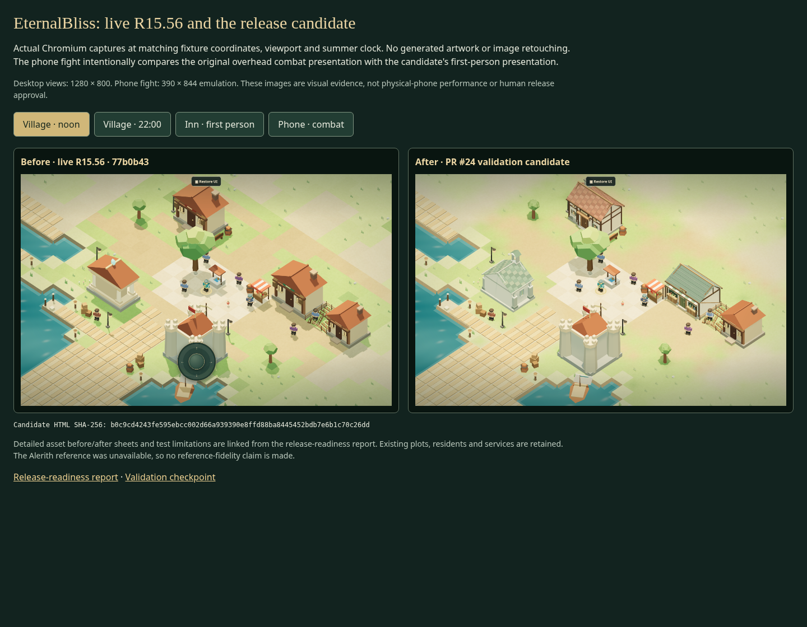

# EternalBliss PR #24 — release-candidate validation

**Available critical local/browser checks passed. Ready for human release review; deployment remains gated.** No merge, deployment, blockchain write or runtime monetization was performed. Physical Android and real two-client shared-world behavior remain unverified.

Validated 16 November 2026, through **09:45 IST**. [Draft PR #24](https://github.com/ch4itu/MagicOver/pull/24) integrates PRs #5–#23. Its original HTML was `f9faf30e118695aa3d93e1f058b0806978b250d58c6287a816fcc1575a61df08`. Validation found one inherited rendering defect and corrected it in `fdf85f69238b845bbdddc7700bdb08915e976c58`.

**Final tested HTML SHA-256:**
`b0c9cd4243fe595ebcc002d66a939390e8ffd88ba8445452bdb7e6b1c70c26dd`

This hash covers the exact standalone `index.html`, rather than a moving branch name. Subsequent commits contain harness, evidence and review documents only. PR #24 shares its feature head with PR #23; validation advances that feature head without changing main. Validation branch: `test/eternalbliss-pr24-release-candidate`.

Browser checks load the pinned source with one test-only renderer reference (`window.__view`) injected for observation. Production has no such hook. Fixture state/RNG and scope stubs are identified below; the natural route uses ordinary earned progression.

## Results and evidence

One sequential regression campaign on the frozen final HTML resolved **59 matrix entries: 53 PASS, six REUSED, zero unresolved failures**. Five reused entries are earlier focused/preflight passes on this exact HTML; the sixth is recovered timing evidence described below. These are suite/checkpoint counts, including source contracts and the intentional live-baseline visual capture, not 59 independent playthroughs. Only failed affected checks were retried. No completed historical overnight suite was restarted.

Two supplemental suites passed: **12 actual first-person rendering fixtures** (nine regions in summer, three other seasons at Wayfarer's Rest) and **local owner-slot isolation**. This does not claim all 36 region/season combinations or authenticated account coverage.

The [machine matrix](tests/release-matrix.json) retains source/script/input fingerprints, first failures, retries, reuse and recorder-recovery provenance. [Append-only evidence](tests/evidence.jsonl) preserves all 115 earlier rows and adds 88 rows from this campaign. [Artifact hashes](tests/release-artifacts.json) cover committed logs and images. Raw machine timestamps use UTC; this report uses IST.

| Area | Observed result and coverage | Limits |
| --- | --- | --- |
| First-person combat | Actual WebGL attack, magic, heal, enemy reply and unlock on desktop, portrait and landscape, mounted/unmounted; overhead fallback; desktop/phone victory, death and flee parity. Five weapon poses on each of three profiles. | Deterministic battle fixtures use fixed combat RNG/stats. Not device performance. |
| Enclosed combat/dungeons | Actual archive Warden attack/reply/flee, fixed-pose rendering, foe visibility, opaque walls/ceiling, overhead cutaway, large-foe corridor and 50 enclosure/anchor cases. Phone Use reaches gate, key, relic and exit. | Most geometry/action permutations use explicit fixtures. The natural quest below provides independent progression evidence. |
| Controls | Desktop, short desktop, touch-capable desktop, portrait phone and landscape profiles: FP movement, D-pad visibility/input where applicable, Clean View and modal/HUD ergonomics. | Chromium pointer/touch emulation, not Android hardware or Safari. |
| Natural Harvest Bell quest | Fresh guest, actual movement and interaction controls: Mira → Millbend key → archive gate → Warden → relic → exit → Mira → reload. No injected coordinates, stats, progress or RNG. Completed uninterrupted on final HTML. | Desktop browser, source-inspected route planning; no claim of a second natural phone playthrough. |
| Mira completion | All eight fixture combinations: noon/evening × two legal sides × nearby resident/no resident. Exactly 65 gold and 85 XP once, correct dialogue, persisted completion and no duplicate reward. | Fixture placement is explicit. Natural route also completed with ordinary earned state. |
| NPCs/activities | Tamsin herb work, hours/range/completion guards, Bram/Wren exploration leads, Atlas pin persistence, archive ledger interaction/reread and one saved journal copy. Residents render at their authoritative positions. | Purposeful local behavior and source/state guards; no claim of a general NPC simulation or new settlement density. |
| Horses/boats | Desktop and phone: actual 75-gold purchase/cancel, mount, accepted FP steps, dismount and ownership reload. Real generated mooring, FP Use/dialog boarding, accepted water movement, afloat reload and docking while owning a horse. | Fixtures approach existing legal sites; not a fresh natural journey to every vehicle. Phone exact-source preflight reused. |
| Saves/world switching | Desktop/phone guest movement, Atlas pin and inventory reload; Farlands ↔ Kingdom and 2D/3D switching; return position. Unsupported version 999 remains untouched after input/autosave delay. Synthetic local owner A/B and guest retain separate state. | No real Smaran authentication, encrypted identity restoration or chain save/read/write test. |
| Movement/animation | Controlled six accepted inputs across suspended rendering, bounded catch-up, turning path and relocation/scope guards; 48 matching normal-cadence frames and 72 matching prior gait/movement frames. Browser distance gait, reduced motion and FP eye height passed. | Controlled rendering gap, not measured physical-phone FPS or proof against every stall. |
| Terrain/atmosphere | Desktop/phone seams and bounded geometry, canopy combat hide/restore, day/night/weather profiles, nine region fixtures, all four seasons at Rest, finite camera/geometry, no shader failures in these checks. | No exhaustive climate/region cross-product or hardware benchmark. |
| Shared-world isolation | Protected live map/save/Smaran/shared-world blocks are byte-identical; actual browser stub guards reject solo HUD, quest hints, herb reward and ledger behavior under shared-active scope. Solo movement observer follows the existing shared dispatch return. | **Real two-client MagicBlock behavior is unverified.** Stubs/source review are not multiplayer evidence. |

The natural route earned 26 gold from a cache and 35 gold/75 XP from the Warden, then Mira's 65 gold/85 XP. Final gold was **226**; leveling left **60 XP**, 115 HP and 58 MP. These values and all six quest flags survived reload. See the [event trace](tests/release-logs/matrix-b0-natural-harvest-events.jsonl), [browser log](tests/release-logs/matrix-b0-natural-harvest-1794800577126.log) and [reloaded screenshot](tests/release-images/natural-complete-reloaded-b0c9cd42.png).

## Failure investigation and correction

**Inherited long-frame jump — corrected in game code.** Six actual accepted key steps while drawing was suspended caused a six-tile render snap in both original PR #24 and pinned live R15.56. The bounded renderer-only waypoint queue now follows accepted solo paths, including corners. The first resumed draw travels **2.0825 tiles**, then catches up; all six accepted inputs and inventory remain intact. Local travel uses at most 250ms elapsed time; existing shared/legacy animation timesteps remain unchanged. The queue is capped at 128 points, clears on discontinuities/scope changes, and is never saved or sent over the network. See [original failure](tests/release-logs/original-controlled-long-frame-f9faf30e.json), [corrected observation](tests/release-logs/focused-controlled-long-frame-b0c9cd42.json), [focused ledger](tests/release-logs/focused-ledger.jsonl) and [checkpoint](RELEASE-CANDIDATE.md).

**Paused-pose/action timing discrepancy — reproduced as a harness clock issue.** Under emulated fixed time and slow software rendering, a ten-second wall timeout occurred after only about 1.18/1.70 seconds of emulated gameplay time. The 1.5-second enemy callback and 2.7-second unlock had not both become due. Instrumentation retained the original callbacks; it did not cancel/replace the enemy reply. Fixing only the climate Date while leaving native performance/RAF/timers produced the correct 93 hero HP, 42 enemy HP and unlocked controls in all three paused/running configurations. Older overnight timing discrepancies without this telemetry remain historical observations, not retroactively manufactured passes. See [emulated raw log](tests/release-logs/timing-investigation-1794799409238.log) and [native results](tests/release-logs/timing-probe-native-checked.json).

The native timing run completed all browser assertions and saved its JSON before a **ledger-writer TypeError** (`require.main` was unavailable from a preload). Its raw log and saved results were cross-checked, recorded as recovered evidence, and retained alongside the failed process status. No browser replay was used to repair record keeping. The v2 preload changes only ledger I/O; the Date/timer installer is byte-identical. The resumable driver recognizes that exact equivalence, while still checking source, test, helper and inputs.

**Other first-pass failures required harness/environment corrections:**

- Eight Mira jobs failed before loading the app because the inherited local HTTP server returned empty responses after losing its output stream. A redirected local server restored HTTP 200; all eight affected jobs then passed with native gameplay timers.
- Resident lead measurement occurred during modal animation; Wren's old fixture also placed the hero on a barrel tile. The test now waits for a settled modal and uses a genuinely legal adjacent tile before actual Space/click/tap interaction.
- The gait camera check sampled before a fresh FP frame; foliage checks sampled before the combat stage existed. They now wait for the actual render/stage state. Assertions were retained, and desktop/phone checks passed.
- An early phone boat fixture approached a nearby puddle rather than a connected mooring. The fixture now selects an existing connected mooring and asserts accepted water steps, reload and docking; no game boat/terrain was fabricated.

First failures and retries remain in the matrix history and committed raw logs. The corrected final HTML stayed frozen through the comprehensive campaign. No additional game defect was found in the available checks. A final checkpoint-only resume produced **59 KEEP entries, zero browser launches**, confirming completed evidence is retained.

## Visual comparison

[Open the four-view comparison](RELEASE-VISUALS.html): matching village noon, village 22:00 and FP inn cameras, plus a portrait combat fixture showing the intended camera change. Desktop is 1280 × 800; phone is 390 × 844 emulation. [Capture metadata](tests/release-logs/rc24-visuals.json) records the candidate source and cameras; [baseline metadata](tests/release-logs/live-r1556-visuals.json) records live R15.56. The eight original images are unretouched Chromium pixels. The comparison page's four tabs and image loading were checked separately, without rerunning gameplay suites.

Manual inspection of all four pairs found improved building identity and roof/window/frontage detail, softer terrain transitions, a working desktop Clean View, retained lamp readability at night, and genuine eye-level combat on phone. The [archive phone action capture](tests/release-images/enclosed-live-phone-b0c9cd42.png) also shows an enclosed fight with visible foe and controls. Existing authored asset day/night and FP sheets remain in [the overnight report](OVERNIGHT-REPORT.md); their geometry blocks are unchanged by the RC fix.

The world retains a stylized low-poly appearance and broad sparse areas. Alerith reference material was unavailable in this environment, so fidelity to that reference is **not assessed**. Human visual acceptance remains pending; screenshots and finite-geometry assertions cannot grant it.

## Protected scope and release gates

The source audit confirms byte-identical live blocks for `bliss-map.js`, `saves.js`, `smaran.js`, `duel.js`, `shared-manifest.js`, `r4-tiles.js`, `farlands-map.js`, `world-stream.js`, `world-motion.js` and `shared-world.js`. Existing feature/model/story/climate blocks are unchanged from original PR #24. Production has no test renderer hook, external script dependency, new service, payment or advertising implementation. No program/deployment/config file changed. [Audit evidence](tests/release-logs/matrix-b0-source-audit-1794799408980.log).

PR #2's D-pad CSS is already included; do not merge it independently without reconciliation. Revenue-policy PR #4 contains documentation only; the free-play, non-intrusive-advertising-only model is preserved and monetization remains unimplemented.

Candidate browser helpers blocked non-local non-GET requests. No blocked-request or captured WebGL/shader error log was produced by the campaign. This is a test boundary, not evidence of a successful live RPC/session. No credentials or localStorage save dumps were added to the review artifacts.

- [x] Available critical integrated local/browser matrix and focused correction evidence.
- [x] Natural quest, mobile emulation, controls, saves, dungeons, vehicles and NPC checks above.
- [x] Standalone source/protocol/scope review and final comparison prepared.
- [ ] Human visual review, including phone and dungeon presentation.
- [ ] Physical Android controls, rendering/performance and persistence coverage, or explicit release acceptance of this gap.
- [ ] Authorized real two-client shared-world validation, or explicit release acceptance of this gap. No chain writes are authorized by this report.
- [ ] Explicit approval to merge and subsequently deploy the exact approved artifact.

Main remains pinned to `397a389d17a262b77084fc25c53e7a52566d803d`; live R15.56 is `77b0b430995c9b37b9369bab1399ae5ec706ef80`, with R15.55 rollback `6321565231a81204e4c92c801ef3b9eca3175648`. Test success is bounded by the observations above; it is not a universal no-regression guarantee. Preserve these checkpoints when resuming. Any new HTML edit requires affected focused checks and a new candidate identity before release.
