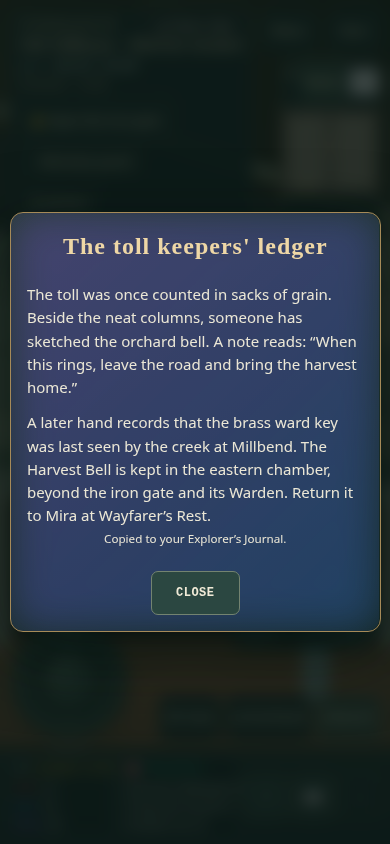

# An authored readable in the archive

The existing book rack at (6, 4) can now be read from one tile away in solo archive exploration. Actual Space/FP Use opens a short authored harvest passage and the established Millbend/gate/Warden/Mira clues. The optional copy appears in the Explorer's Journal and persists in existing `quest-vault-ledger` spent flags. It changes no quest objective, key, gate, reward, inventory or save schema. Existing exit/enemy/gate/relic proximity priority stays ahead of reading. Shared and legacy scopes do not expose the note.

Desktop and phone-emulated actual Use/tap, Space reread, unchanged inventory/XP/position/objective, no six main quest flags, single journal copy, reload, out-of-range behavior and read-only scope guards passed on `378f9dc4`. New-candidate smoke passed. Initial screenshots caught the old modal entrance animation; final capture cases wait for opacity 1 and finished animation without replaying the passed interaction/save checks.

Final HTML `0781ec4c7d2b037fa50fadb566a15754dad594cb3f641072a7b386a317bcd509` only wraps the passage in left-aligned 15px / 1.55 line-height reading type with paragraph spacing. Settled desktop/phone viewport-fit captures passed; final candidate 3D/FP/2D smoke recorded separately. Functional/save evidence is reused for this style-only refinement. Screenshots visually reviewed. No live shared-world transaction or physical-phone claim.

