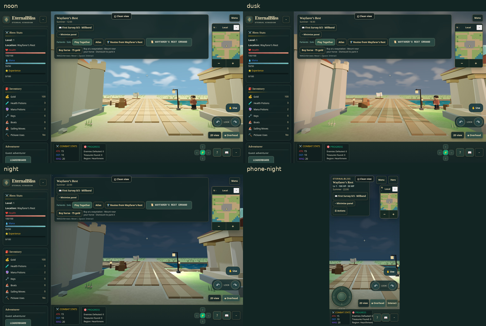

# Climate sky and lighting — overnight milestone 5

One 325-vertex, camera-centred sky dome provides an outdoor solo Farlands FP gradient, slowly drifting clouds, sun/moon discs and sparse night stars. No texture downloads, particles or new weather state. The existing climate phase sets colour and directional-shadow orientation; original hemisphere-light settings remain. Shared/legacy worlds and interiors retain their existing sky/light path. Reduced motion freezes cloud drift.

HTML `5ed54355a0f504ea16d0229407b3b0bf92ca8777a1f67760fbf4e36e9c2ca53b`. Actual Chromium shader/framebuffer checks passed at noon, dusk, night and phone night: no shader compilation failures, non-black varied sky output, finite climate vectors, bounded dome, and unchanged player/inventory/terrain edits/world clock. Shared-active stub and legacy-world visibility guards and reduced-motion freeze passed. One final-candidate 3D/FP/2D smoke passed. No full matrix was repeated.

The first two-pixel assertion sampled one cloud patch, so the harness was refined to an upper-sky sample grid. Its failed log remains; no product change was made for that assertion. Captures are real render evidence, not an FPS benchmark or a claimed Alerith match. No volumetric/cloud shadows, new weather simulation or physical-phone performance claim. No merge/deployment/chain writes/monetization.
