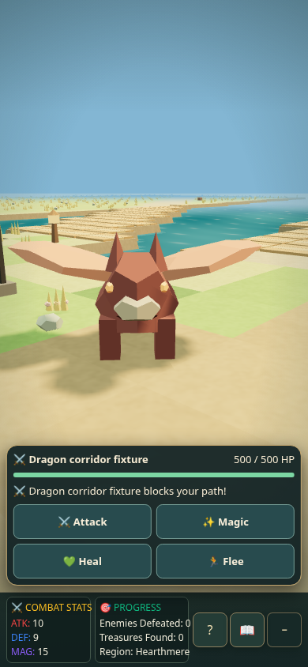

# First-person combat corridor correction

Follow-up on PR #6, stacked on the unchanged inn-prototype branch in PR #7. No new architecture or other visual milestone is introduced.

A new real-building regression fixture reproduced a placement defect on HTML `d56473a149fe89be9cb5fc4327a19f6369117e2b894683f4b3685807d04c5bf4`: standing at `(5059,4863)`, looking north toward the inn, put a dragon at `(5059,4860.35)` inside its blocked footprint. The old clearance check stopped at 2.1 tiles while the dragon's guard distance was 2.65 tiles.

Direction selection now runs after the enemy model and guard distance are known. It samples the corridor through the guard/recoil distance, including the enemy's width, and chooses once per encounter. Open-field forward placement retains its existing guard distance. The established fallback remains when none of the available directions fits; this does not establish safety for every cramped room or guarantee arbitrary meshes never intersect scenery.

Only render placement changes. Player tiles, map/collision data, damage, HP/MP, rewards, saves, shared-world protocols and monetization are unchanged.

## New checks, without repeating completed suites

Candidate HTML SHA-256: `8b236d55c40b45bfe089e3c02dd85c55ed30825dcd2153eba7f7a858d737c47a`.

- Real Chromium, desktop 1280×800 and phone emulation 390×844: the dragon is outside the inn footprint, staging preserves player position and HP/MP, an actual Attack and enemy reply yield the expected HP/damage, and a clear-field encounter retains its guard distance and forward aim.
- One short startup / 3D / first-person / 2D smoke on the changed candidate passed. Existing completed matrices were not rerun.
- Initial candidate test tripped on JavaScript `-0` versus `0` in a strict vector assertion after the functional checks passed. The harness now compares numerical equivalence; no product change was made for that assertion.
- Source/script hashes and outcomes are appended to [evidence.jsonl](evidence.jsonl). Raw logs and captures are retained under `/workspace/.magic-over-setup/corridor-*`.

Run only when this behavior or its inputs change:

    NODE_PATH=/workspace/.magic-over-setup/browser/node_modules node eternalbliss/tests/corridor.cjs

The fixture exercises a synthetic encounter against a real inn footprint in an isolated guest profile. This is not a natural quest playthrough, physical Android performance measurement, or live multiplayer test. Prior release gates remain. No merge, deployment, chain writes or monetization.
