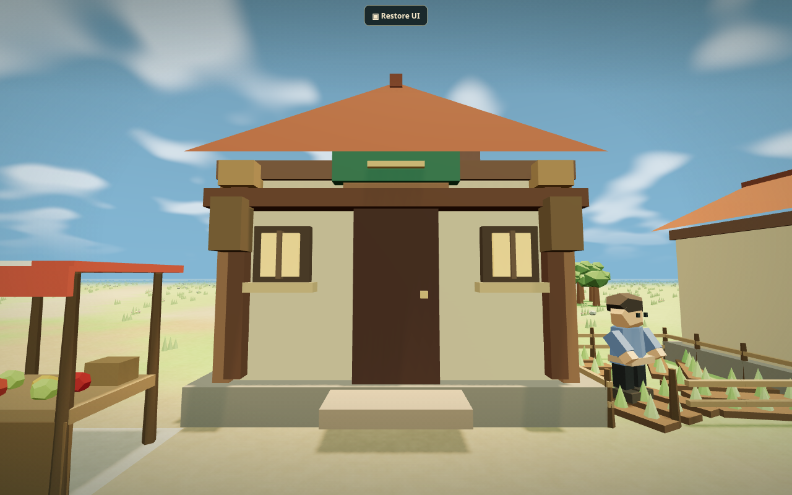
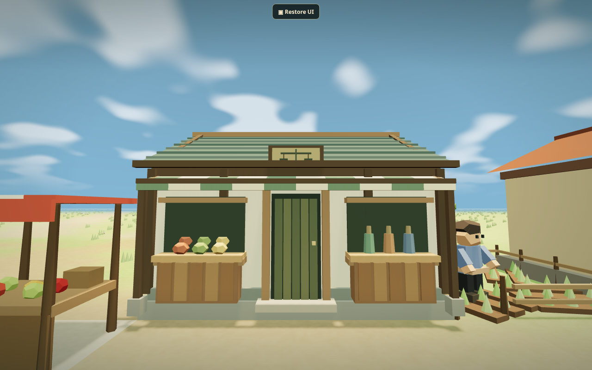
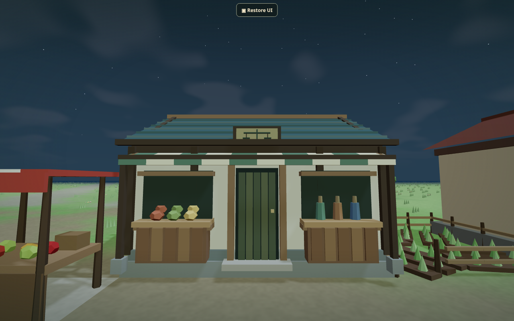

# Wayfarer's Rest Exchange

Only `rest-service-1` uses the new model. It remains on its existing 3 × 2 footprint, with a centred door, shallow threshold and frontage. An asymmetric slate saltbox roof, braced timber, recessed shelves, paneled counters, authored wares and striped linen distinguish it from the taller inn. The front extent is 1.23 units; the next legal tile centre is 1.5 units away. No world props, NPC positions, map tiles, shop prices or inventory logic changed.

The static mesh uses 30 shared material batches / 4,758 vertices. `exchange-budget.cjs` passed finite geometry, bounds, cache reuse and independent instance transforms in Node using bundled THREE. It also compares geometry/material hashes against the archived parent HTML: authored inn output and generic inn/shop/house output are exactly unchanged after extracting the baking helper. This is a resource contract, not an FPS result.

`exchange.cjs` captured summer noon and 22:00 first-person/overhead before and after at fixed cameras. Candidate checks passed all six blocked footprint tiles, a walkable approach, and actual first-person Use / Enter / Exit. New-candidate 3D/FP/2D smoke is recorded separately. Captures were visually reviewed for roof seams, door clarity and night readability. No physical-phone performance claim or Alerith-match claim.

Candidate HTML: `e6ebd0d925ed907e759de6482d2f73d95de1259bcf359190e2d1b0ec86cb51a7`.

