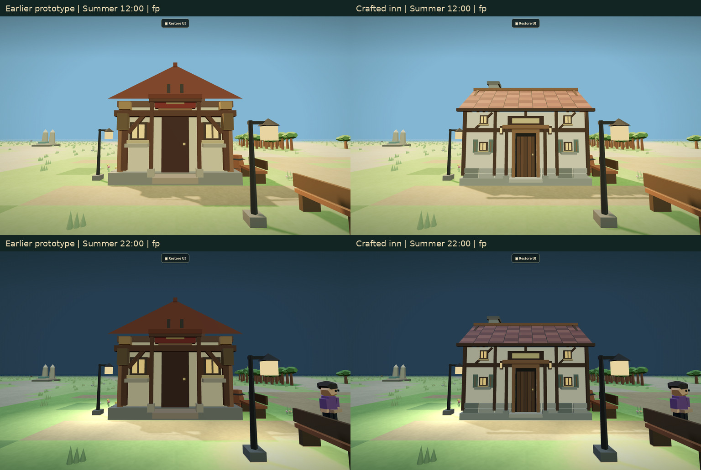
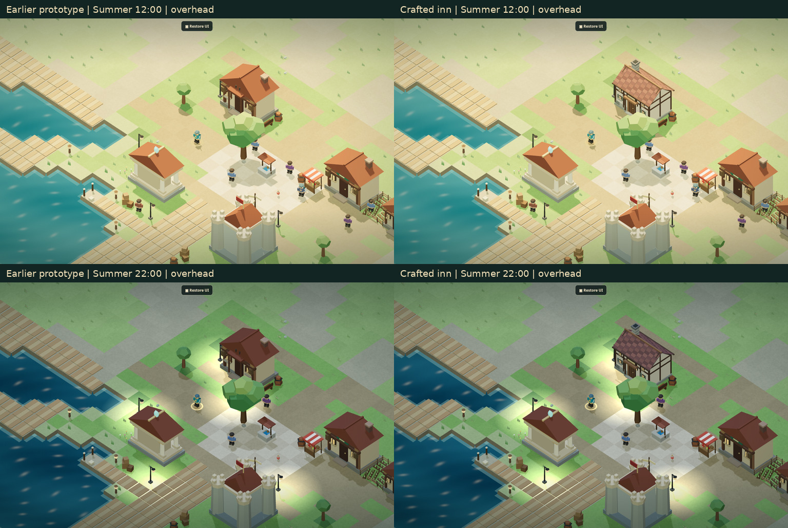

# Crafted inn, overnight milestone 2

Only the existing Wayfarer's Rest inn is rebuilt. It uses its existing three-by-two footprint directly, with a real pitched roof and tile courses, dark under-roof, gable ends, timber frame, shutters, stone footing, supported threshold and chimney. Named identity, map position, door/service and room are retained. No new settlement, building or NPC.

The static asset bakes into 28 material batches and 4,338 vertices; repeated instances share immutable geometry/materials while transforms are independent. `architecture-budget.cjs` verified the resource contract using the bundled THREE library in Node. This is not a frame-rate or physical-device benchmark. Other building renderers remain unchanged.

Final HTML SHA: `cfcd0d8bcb1ac19742c1c6f97de4942879e2470b6c36b6d86ca9f296adec72e1`. New actual-browser captures: summer 12:00/22:00, FP/overhead, same cameras, fresh fixed-clock profiles. A roof-joint gap was observed in the initial captures and corrected before these final images. Original logs/images remain. Actual Use/Enter/Exit and collision checks passed on the initial architecture candidate; the roof-only correction preserves those contracts and reuses that evidence. One final-candidate startup/3D/FP/2D smoke passed. Earlier unchanged inn baseline images were reused.

Alerith reference assets were unavailable; this is original craft work on the existing art, not a claimed match. Visual review remains required before merge. No monetization, deployment or chain writes. See the append-only ledger and OVERNIGHT.md for continuation.
