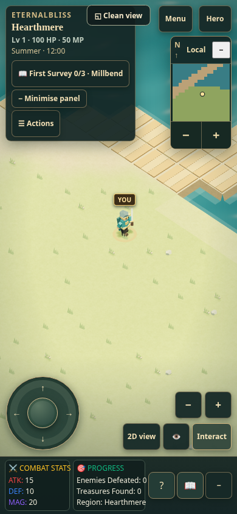

# Solo distance-driven locomotion

The solo Farlands hero and seven existing Wayfarer's Rest residents now advance limb phase by actual rendered distance. Strides ease in and settle at a stop; idle actors do not keep pedalling. A small torso roll/breathing pose adds weight without changing model scale, collision, authoritative positions, movement interpolation or input cadence. The FP camera stays at its original eye height. Combat, mounted/sailing, shared and legacy poses retain the old path; reduced motion has neutral limbs and no torso roll. Tamsin's work pose still uses its existing separate blend.

HTML: `31c675f5af1ee44e660fbfdbbf8e1b6289aebc2626a6fed62091eafae6f69e5f`.

- `gait-contract.cjs` runs the actual extracted method in Node. Hero/resident strides match across 30/60 simulated FPS and different absolute times; idle phase freezes and eases out; relocations/reduced motion reset. All 72 old/new movement/heading frames match, including turns, diagonals and a relocation. Shared/legacy/battle/horse/boat scenarios retain original limb output. These are simulated transforms, not live multiplayer or measured FPS.
- `gait-browser.cjs` passed actual desktop keyboard movement and phone-emulated CDP touch drag, stationary phase/settle, unchanged inventory, real resident rendering positions, and stable FP eye height. Reduced-motion phone emulation records zero limb/torso movement while input still moves the hero. Frame samples are saved in overnight-evidence. The passing desktop script version is retained there; the current harness checks resident positions before moving beyond mobile culling range.
- New-candidate 3D/FP/2D smoke is recorded separately. Existing game-rule/control/quest suites are reused for unchanged code.

Failed harness checks are retained: strict Node equality distinguished -0 from 0; the first browser observation missed motion, then instrumented desktop frames confirmed it without a product correction; the first phone assertion expected residents beyond the phone render radius. Sampling now starts at actual travel and resident checks happen near the village. No product change was needed for those browser harness corrections. Physical-phone performance and the inherited long-frame movement-jump risk are not closed by this test.

