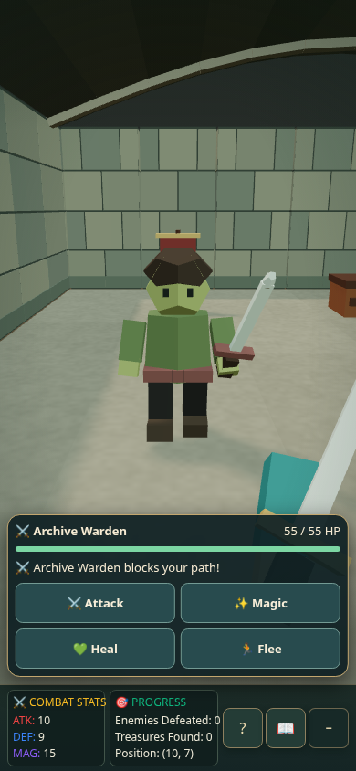

# Combat inside the enclosed archive

HTML remains `31c675f5af1ee44e660fbfdbbf8e1b6289aebc2626a6fed62091eafae6f69e5f`; this milestone adds evidence only. Earlier combat images used low walls, so they did not prove visibility with the new enclosure.

Desktop and 390 × 844 phone emulation passed five fixed-age production poses (guard/attack/magic/heal/enemy). For each pose, five sampled foe anchors are within the eye frustum and have no wall/ceiling ray obstruction; chest stays above the combat HUD, hands stay visible and locomotion is excluded. This is 50 sampled visibility checks across both profiles, not a guarantee for every model pixel/location. Guard/attack screenshots were reviewed. Desktop's passing diagnostic script is retained in overnight-evidence; the final `enclosed-combat.cjs` is render-only.

`enclosed-actions.cjs` separately passed a normal running renderer with no replaced action/timer functions: actual attack gives Warden 42 HP, actual reply leaves hero 93 HP with fixed RNG, actual flee restores eye exploration/gait without awarding the guardian flag. Both desktop and phone passed. This is a staged archive combat fixture, not a second natural quest playthrough. Existing unchanged-candidate smoke is reused.

Two early combined paused-capture/action runs missed the enemy reply (one timed assertion, one state-wait timeout). An instrumented desktop run passed, but that does not explain the earlier failures. The normal unpaused test then passed both profiles. Pose capture and action/timer validation are now separate tests; earlier logs and diagnostic script versions remain available. Do not use a paused-render capture as timing evidence.

