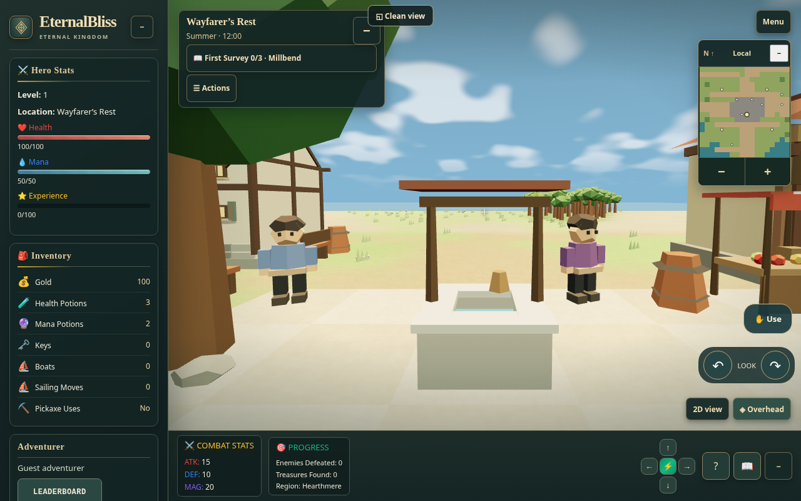

# Desktop first-person card

The existing location card covered 814 × 235 pixels in the 1280 × 800 baseline. Solo Farlands first-person desktop now uses a 330 × 156 card and the existing Actions disclosure. Short desktop (1280 × 450) hides only the redundant clock while closed, measuring 330 × 133. The current goal and essential contextual actions remain available. Atlas, shared-entry and optional travel/help actions are revealed with Actions. Manual minimize/restore uses the existing handler. Overhead and phone CSS retain their previous layout.

`fp-hud.cjs` passed actual Actions/Atlas open-close, minimize/restore, overhead restoration and unchanged player/inventory checks in desktop, short desktop and 390 × 844 phone emulation. The phone card was 214 × 223; this change makes no phone-size claim. New-candidate 3D/FP/2D smoke is recorded in the ledger. Screenshots use the same fresh guest and fixed summer-noon clock. No interaction, persistence or shared protocol code changed.

Baseline: `39953c92`. Candidate HTML: `90aab30bc33c024d66d464d8bda0bd386a333408445a38c24ea77f962e54ecd5`. Failed candidate logs are retained in overnight-evidence: the first harness used an obsolete collapse class, then the width check caught content-box padding. Corrected CSS uses the live collapse class and border-box width. These are not additional passes.

