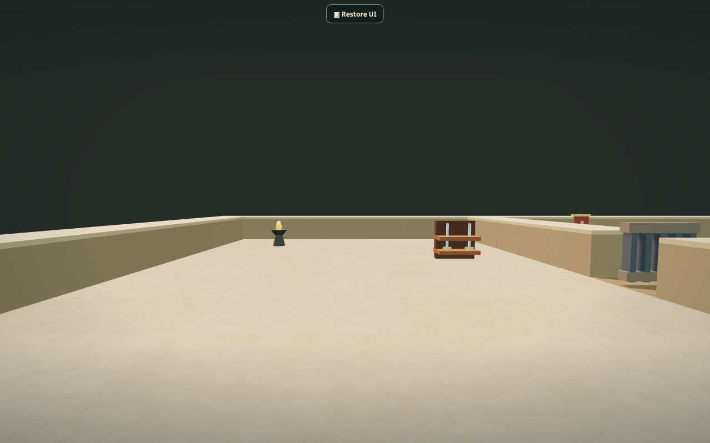
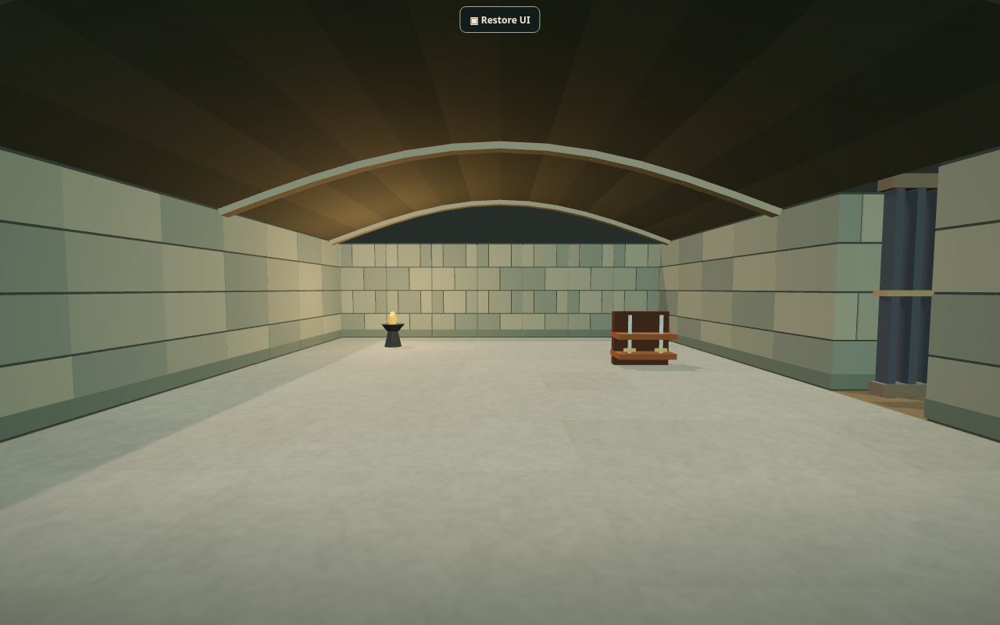
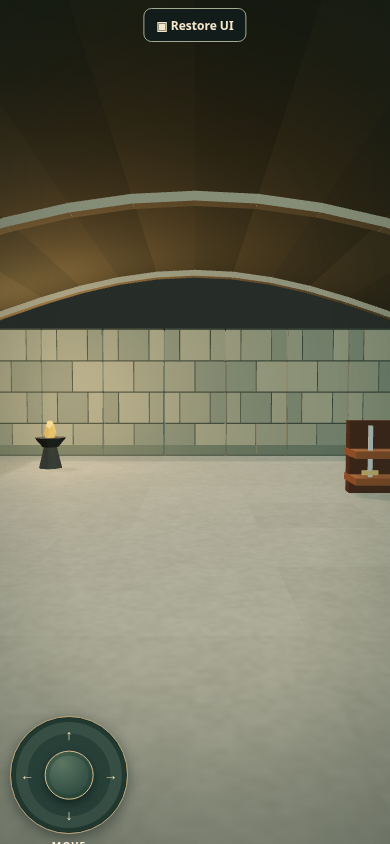

# Harvest Archive enclosure

First-person archive walls were only 0.7 units tall beneath a 1.135-unit eye, exposing the entire dungeon as an open courtyard. The same wall tiles now render full-height masonry in solo archive FP. A pair of shallow barrel vaults follows the existing two chambers, with ribs and two warm, non-shadowed fills at the existing braziers. The gate matches the wall height. Overhead keeps the existing low cutaway and hides the ceiling/lights. No layout, collision tile, gate/reward rule, actor position or save change.

`archive-architecture.cjs` passed desktop and phone-emulated actual WebGL checks: eye-level wall ray hits at 3.509 units, upward ceiling hit at 1.82; 3 shared ceiling material batches / 4,464 vertices, 2 fills, 872 terrain instances. Coordinates, inventory and all 255 authoritative tile types were unchanged by rendering. Actual closed-gate Use and exit cleanup passed on `425ea653`. Final backing-only correction (`2ac3ab02776e2df1ad94d90139297f96d5f7b72631980c7c026b930f03034c74`) exposes side-facing masonry joints; desktop/phone render/resource/state/cutaway checks passed, reusing unchanged gate/exit evidence. Final new-candidate 3D/FP/2D smoke passed.

The first harness asserted visibility immediately after clicking, before the render frame. Visibility now updates every frame; the harness waits for that frame. Initial captures also needed explicit warm frames; final hash-named captures wait for three rendered frames and finish WebGL before capture. Earlier logs/captures remain separate where retained. Fixed-camera before/after and overhead were reviewed. Not physical-phone performance or live shared-world evidence. The previously completed natural route is reused for unchanged quest rules.

