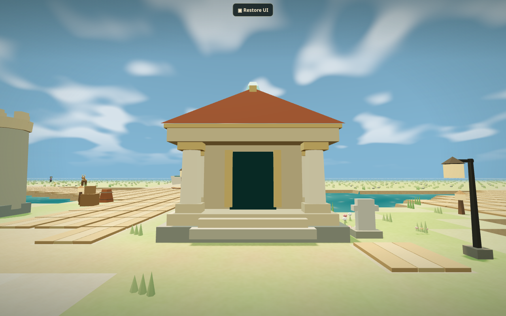
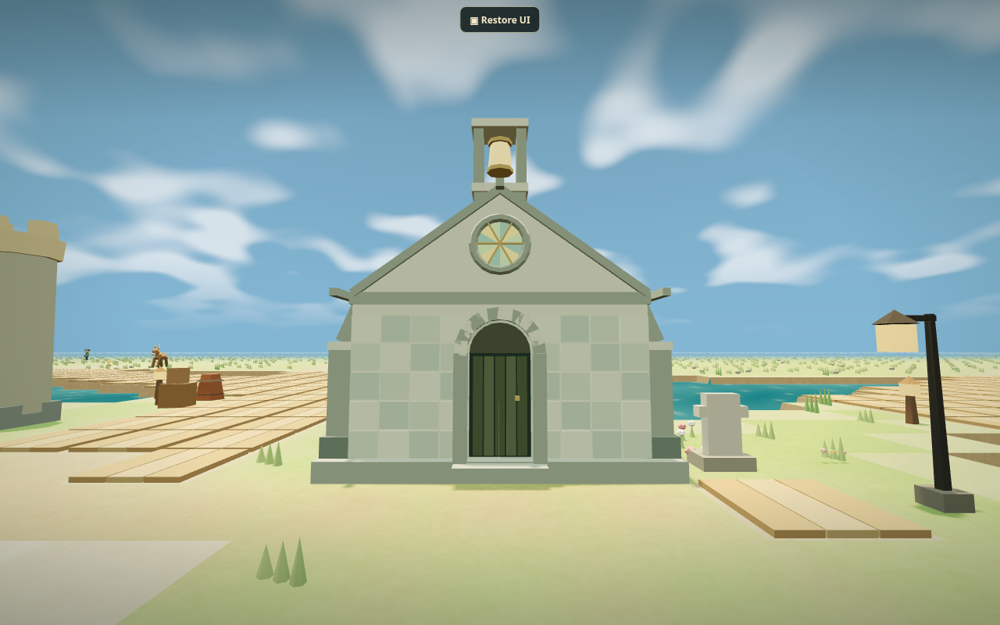
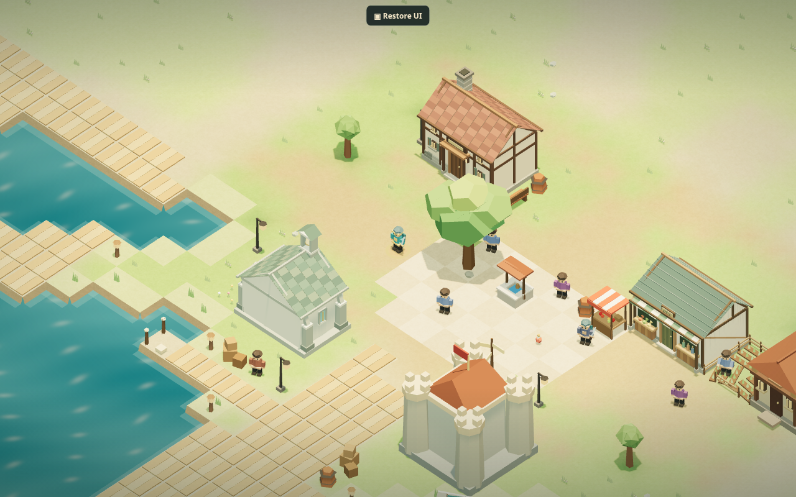

# Hearthlight Chapel

Only the existing `rest-service-2` temple uses this authored asset. Its north-facing door still opens toward the square on the same 3 × 2 plot. Cut limestone, buttresses, a round glass light, an arched entrance, steep slate roof and supported lantern cote distinguish it from the timber inn and trading frontage. No new building, NPC, map/collision tile, price, healing or persistence behavior.

`chapel-budget.cjs` passed real bundled-THREE Node checks: 22 shared material batches / 5,862 vertices, finite geometry, bounds (front 1.15; legal next tile centre 1.5), cache reuse and independent transforms. Exact old/new geometry/material digests preserve the authored inn/Exchange and generic inn/shop/house/temple. This is a resource contract, not an FPS benchmark.

`chapel.cjs` fixed summer noon/22:00 FP/overhead before/after captures were reviewed for door visibility, supported roof details and night readability. Actual first-person Use, existing blessing offer, Enter/Exit, six blocked footprint tiles and walkable north approach passed. Final new-candidate 3D/FP/2D smoke passed. HTML `f9faf30e118695aa3d93e1f058b0806978b250d58c6287a816fcc1575a61df08`. No physical-phone performance or Alerith-reference fidelity claim.

