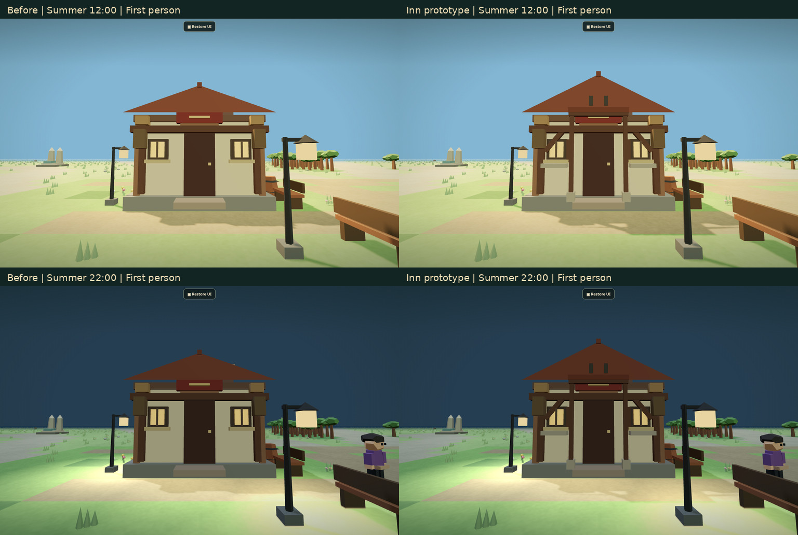
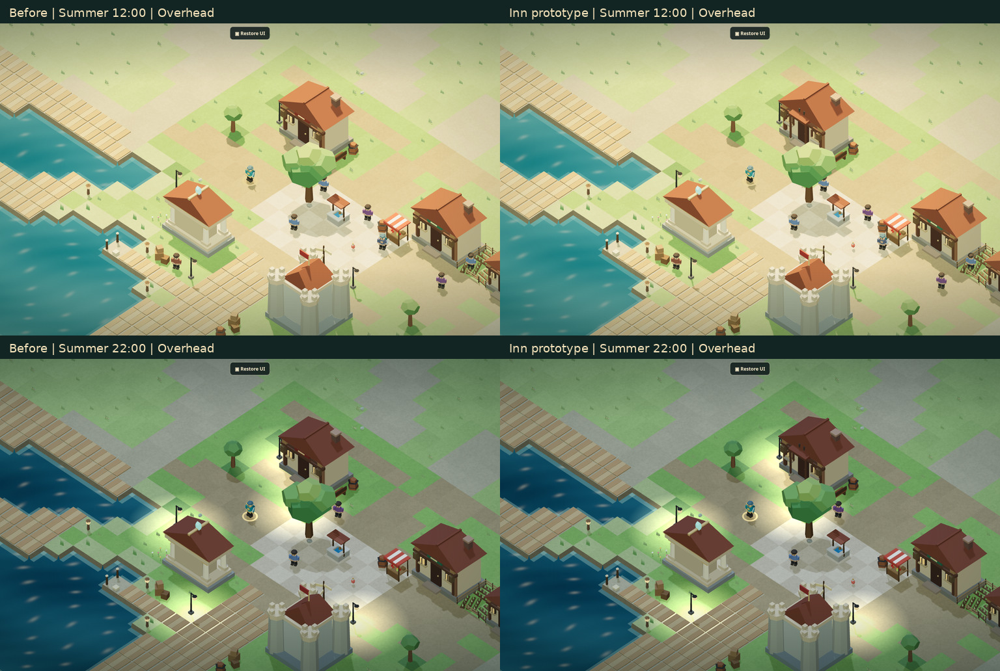

# Wayfarer's Rest inn — one-building prototype for review

This branch builds on `feat/eternalbliss-fp-combat-r1556`. It changes only the existing inn (`rest-service-0`): a steeper roof, braced timber frontage, deeper window sills and a shallow shelter at the original threshold. The original wall dimensions, doorway, village layout and collision footprint stay in place. Other buildings use the original renderer. No new NPCs, buildings, quests, textures, remote assets, sounds or monetization.

## Compare before accepting the visuals

Columns are the original inn and the prototype. Rows are summer noon and 22:00. These are actual Chromium captures at the same player/camera position, in Clean View; the sheet only resizes and labels the captures. This is not a physical-device performance test.

Baseline HTML SHA-256: `09dfa95be03e56d4c32603e0a53e1705aa39d7665199736f8315974b3932ae55`.
Prototype HTML SHA-256: `d56473a149fe89be9cb5fc4327a19f6369117e2b894683f4b3685807d04c5bf4`.

Startup/3D/FP/2D smoke passed on the prototype. Actual Use → Enter building → Exit worked before and after. The captured contracts match byte for byte: building `(5059,4860)`, footprint `(5058,4859,3,2)`, all six tiles blocked, original approach walkable. Functional checks are reused while pictures are refreshed. The first capture attempts were rejected for inconsistent rendering caused by changing a mocked clock after app startup; their logs remain. Final captures initialize the clock before loading each profile and verify valid sky values.

Raw captures, logs and contract JSON are retained in `/workspace/.magic-over-setup/eternalbliss-evidence/`; [evidence.jsonl](evidence.jsonl) records source and script hashes. No aesthetic approval is implied. Keep this prototype separate from the combat fixes; review these pictures before accepting it or changing another structure. Nothing is merged or deployed.
