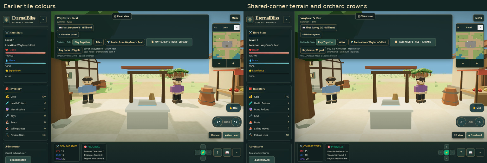

# Farlands landscape rendering — overnight milestone 3

Natural soft ground now shares cached corner colours across neighbouring tiles. Additional centre triangles at path/type boundaries retain the path's centre colour. Shore geometry, authored stone paving, bridge planks, tile types and collision are retained. Existing orchard trees keep their rooted trunks/locations and gain connected asymmetric rounded crowns through one additional instanced batch. No new tree scatter or map edits.

HTML `b27626886039f3b4fa803c70e495579ebc4beca013e2a6dd2ab301a5e9b16656`. New actual-Chromium tests: zero seam difference at 1,534 desktop and 1,142 phone-emulated mixed corners, after explicit full-FP terrain readiness. Ground geometry: 107,226 / 71,574 vertices, eight instanced scenery batches. These are resource/geometry checks, not FPS claims. Player state, inventory, edits, tile samples and collision footprints stayed unchanged. New canopy instances were hidden/restored by the existing combat occlusion system. One new-candidate 3D/FP/2D smoke passed.

The baseline failed the new continuity assertion (maximum channel difference 0.285). Initial candidate evidence sampled the smaller pre-FP-radius mesh; the later full-radius cases explicitly wait for the FP terrain signature. Existing gameplay outcome matrices were reused for unchanged code. Logs and screenshots remain in overnight-evidence; the append-only ledger pins each source/script hash. Physical Android performance and release gates remain open. No merge/deployment/monetization or chain state writes.
