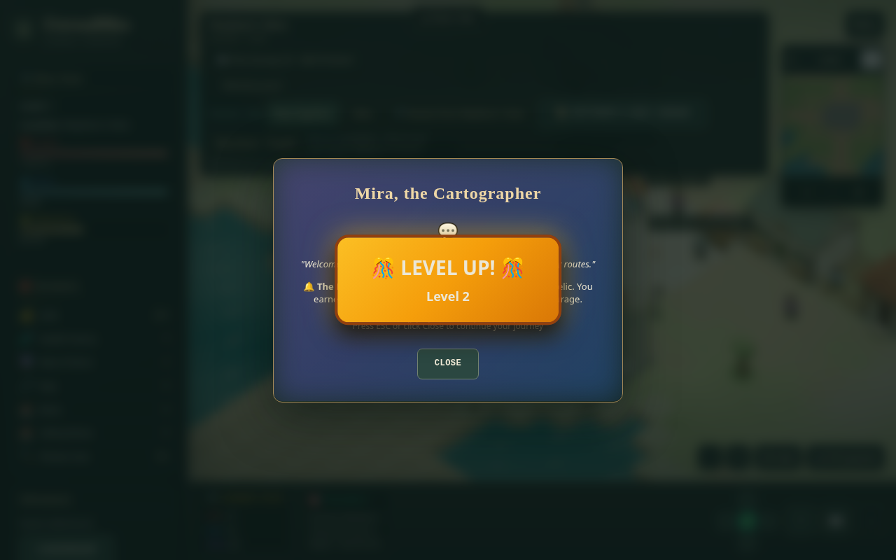

# Harvest Bell journey from a fresh guest

Candidate: Exchange HTML `e6ebd0d925ed907e759de6482d2f73d95de1259bcf359190e2d1b0ec86cb51a7`, desktop Chromium 1280 × 800, fixed summer noon installed before startup. `natural-harvest.cjs` plans paths from read-only map/state inspection and uses real keyboard/buttons for all travel, dialogue, pickup, entry, combat and use. It does not inject coordinates, stats, RNG, inventory or quest flags.

Observed sequence:

- Fresh guest: 100 gold, 0 XP, 0 keys, no quest flags.
- Talk to actual Mira, walk to creekside Millbend, collect the ward key (1 key).
- Walk to the Old Tollhouse, actual Space / Enter, walk to gate, FP Use consumes the key once.
- Three actual Magic actions defeat the Warden. Natural saved result: 88 HP, 14 MP, 161 gold, 75 XP, guardian flag true. The route incidentally collected a 26-gold cache; Warden adds 35.
- Resume that recorded local save, walk to Bell / actual FP Use, walk to exit / Use, return to actual Mira.
- Assert +65 gold at Mira and no second gold reward. Completion yields 226 gold, 60 XP after level-up; all six story flags persist after reload. Existing focused Mira evidence covers exact XP/idempotency inputs separately.

The first harness attempted another button during the three-second victory delay: controls had correctly disabled, then hidden, so Playwright timed out. Product code was unchanged. The corrected harness recognizes an enemy with zero HP and waits for battle exit. The successful continuation reused the actual saved Warden victory; it did **not** restart the journey. This is a natural route across two executions with a recorded local-save resume, not an uninterrupted run or a staged key/relic fixture. V1 script SHA: `2d6df0e5445698abcf22fa65b2b8aac491cb5383b8b31563c0e50c6fa3fdbf79`; V2 script SHA is in the ledger.

Raw events, failed/success logs, screenshots and isolated guest storage checkpoint remain in `/workspace/.magic-over-setup/overnight-evidence`; full storage is deliberately not committed. Checkpoint events are committed as `natural-harvest-events.jsonl`. Reuse this completed result for unchanged code/inputs. No application code changed, so the already-passed candidate smoke was reused. Physical Android and live multiplayer remain unverified; a final release candidate still needs its required final matrix.

