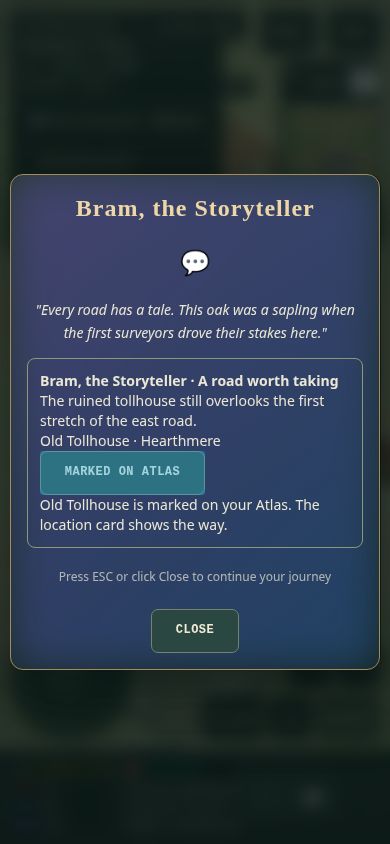

# Bram and Wren's road leads

Existing residents now offer distinct, discovery-sensitive leads using the existing landmark descriptions. Bram follows the active story destination when appropriate; otherwise his local road stories and Wren's pilgrimage places advance past visited landmarks. An in-range conversation offers a 44px “Mark …” action using the existing persistent Atlas pin. No teleport, discovery or reward is granted; existing journal entries/quests and generic residents retain their behavior.

HTML `39953c92b65ad2f670fedb75126b2aa595639f13fa7af6a151829af9aaae3fc4`. Desktop actual Space/click and phone-emulated tap, target size, unchanged player/inventory/XP/discoveries and saved pin reload passed. A prior-visited fixture advanced Bram's lead, Wren offered a distinct destination, and stale range/shared-active stub refused marking. One new-candidate startup/3D/FP/2D smoke passed. This is UI/save evidence, not a natural exploration route or live multiplayer test. No monetization, merge, deployment or chain writes.
