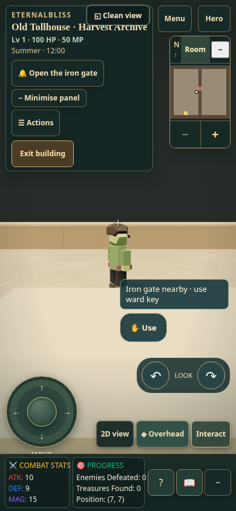

# First-person archive interaction

The old first-person ray could select the distant Warden through a wall, returning “too far” and ignoring a reachable iron gate. A new fixture reproduced that failure. Reachable forward archive actions now route through the established proximity interaction first; a small read-only hint identifies the gate, enemy, relic or exit. Existing priority/ranges, gate-key/reward rules and shared worlds are retained.

HTML `40dc5555cc73d93702956acb874d6378327f7e23e5f3f10a6c495abda0523f19`. New desktop/phone browser routes used actual Use, relative keyboard movement and combat buttons: gate opens/key spent once, Warden rewards correct, Bell recovered, exit works, flags/key persist on reload. They start from an explicit ward-key/camera fixture; this is not the full natural outdoor quest. Locked gate without the quest-key flag cannot consume a generic key; shared-active stub and outside-vault hint guards passed. One new-candidate 3D/FP/2D smoke passed.

The initial route harness incorrectly assumed automatic interior item pickup; it was corrected to explicit Use. The first guard fixture supplied an incomplete object to the save packer; it was replaced with the supported restore fixture. Both failures remain in separate logs and caused no extra product changes. Existing passed matrices were not restarted. No merge, deployment, monetization or chain writes.
