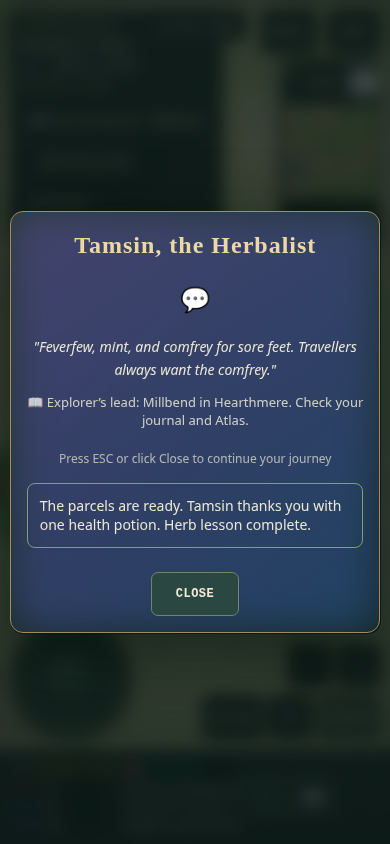

# Tamsin's herb-bundling lesson

A useful activity for the existing herbalist at her actual scheduled work spot, 06:00–18:00 in the game clock. Talk with Space/Use and help sort three labelled parcels. Incorrect answers give feedback without consuming resources. The first completion grants one health potion; the existing sparse journal records completion across save/reload. Partial lessons restart when reopened. No gold/XP reward, repeat farming, new NPC, new save schema or monetization.

Her idle sorting pose changes only arm animation at her true location; it eases in/out and respects reduced motion. Schedule movement remains authoritative. Completion rechecks actual presence, time, range, current solo scope and existing journal flag.

HTML `1ba5c67b457f50a0481f6ba812f4a23b998aa6b95798e13f15d8147ae8b4b794`. New actual-Chromium evidence: desktop/phone Space and choices, wrong-answer/no-reward, 44px choice targets, exactly one potion with gold/XP unchanged, save/reload idempotency, render/NPC position agreement, evening unavailability and stale-range refusal. Additional actual-final-answer shared-scope stub, after-hours and outside-Farlands refusal checks passed; these are not live multiplayer. One affected Mira reward/reload case and one new-candidate 3D/FP/2D smoke passed. Existing matrices were not restarted.

Raw evidence is in overnight-evidence and source/test hashes are in the append-only ledger. This is an isolated guest fixture, not a natural full quest run or physical-phone benchmark. No merge/deployment/chain writes. Existing release gates remain.
