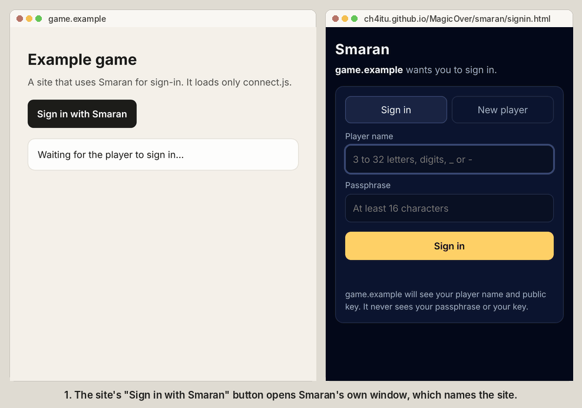

# Smaran

Smaran lets a player sign up for a Solana app with a player name and a passphrase. There is no wallet app, no seed phrase and no SOL to buy. The same name and passphrase bring the same player back on any device, and in any app that uses Smaran. Smaran is Sanskrit for remembering: remembering a name and a passphrase is all a player needs.

It is the sign-up that [Magic Over](../README.md) runs, packaged two ways for other sites: a sign-in window on Smaran's own page, so the site never sees the passphrase or the key, and one file, `smaran.js`, that a page can load.

**Try it:** [ch4itu.github.io/MagicOver/smaran](https://ch4itu.github.io/MagicOver/smaran/). If you already play Magic Over, sign in there with the same name and passphrase and you get the same player key. You can also change your passphrase there.

<p align="center"></p>

<p align="center"><sub>The sign-in window, opened by a demo site (game.example) and stepping through sign-in and one signature.</sub></p>

**Status:** working on Solana Devnet with MagicBlock's Ephemeral Rollup. Tested in fresh browsers with nothing saved, across two apps (Magic Over and the Smaran page), and with the sign-in window opened by a site on another address (in a desktop browser; the window is not yet tested on a phone). Not on mainnet yet.

## What Smaran is, and what it is not

**It is a login.** A player in a game, a member of a community, a voter in a poll: something a person should be able to start using in seconds and carry from app to app. The player never sees a wallet, a key, SOL or a fee. The app pays the chain costs, the way it pays for its servers.

**It is not a wallet.** A Smaran account holds no money. The locked copy of the key is public (that is what makes it free and serverless), so its safety depends on the passphrase: fine for a login, not for money. Anything of value belongs in a real wallet, and apps that take payments should do it through a normal payment provider or a licensed partner, never through the Smaran key.

**It can be disposable.** If a player forgets the passphrase, they lose that player and start a new one. Apps should treat the player key like a username they recognise, not like a bank account.

## How it works

1. **Sign up.** The browser makes a random signing key. It does not come from the passphrase.
2. **Lock.** Argon2id (64 MiB of memory, three passes) turns the passphrase into a key that locks a copy of the signing key with XChaCha20-Poly1305. Each player gets a random salt, and the locked copy is tied to the player's name, public key and network, so it cannot be moved to another name or network. The passphrase never leaves the page.
3. **Register.** After a small proof of work, the page stores three things in the player registry on MagicBlock's rollup: a hash of the name, the public key and the locked copy. The player's own new key signs this, with 0 SOL. The rollup then saves the player's registry group to Solana; each group pays for its own saves from a small reserve the sponsor put in it.
4. **Sign in anywhere.** Another device or app reads the locked copy by the name, unlocks it in the browser with the passphrase, and checks the key matches the registered public key.
5. **Change the passphrase.** A player who still knows the passphrase can lock the same key with a new one. Only that player's key can replace its locked copy, and the player key never changes.

## Add it to your app

There are two ways. With the **sign-in window**, the player types the passphrase on Smaran's own page, and your site never sees the passphrase or the key. With **smaran.js in your page**, your page unlocks the key itself: simpler, but players have to trust your site with their key.

### The sign-in window

```html
<script src="https://ch4itu.github.io/MagicOver/smaran/connect.js"></script>
<script>
  signInButton.onclick = async () => {
    const player = await SmaranConnect.connect(); // opens Smaran's window; call it from a click
    player.name;                                   // 'asha-k'
    player.publicKey;                              // the player's Solana address (base58)
    await player.signMessage('example.com sign-in, nonce 8f2c'); // the player approves it in the window
    await player.signTransaction(tx);              // web3.js Transaction or VersionedTransaction, signed in place
    player.onDisconnect(reason => {});             // the player signed out or closed the window
    player.disconnect();
  };
</script>
```

| Call | What it does |
| --- | --- |
| `SmaranConnect.connect()` | Opens the sign-in window and resolves with the player once they sign in or create a player there. Call it from a click, or the browser blocks the window. |
| `player.signMessage(message)` | Text or bytes. The window shows it and asks the player. Resolves with a 64-byte signature. |
| `player.signTransaction(tx)`, `player.signAllTransactions(txs)` | A web3.js `Transaction` or `VersionedTransaction` gets the player's signature added; transaction message bytes give back the signature. The window lists the programs used and asks the player. |
| `player.disconnect()`, `player.onDisconnect(fn)` | Signs out, or tells you when the player signs out or closes the window. |

A request that does not go through fails with an error whose `code` says why, for example `rejected` (the player said no), `refused` (the window does not sign that) or `signed-out`.

What the window does:

- It shows your site's address as the browser reports it, not a name your site sends.
- It runs only in its own window: not inside another page's frame, and not for sites without https (localhost is allowed for development).
- It asks the player for every signature, and refuses a transaction passed off as a message.
- It never signs a sign-up or a passphrase change for a site. Since 5 November 2026 the registry also refuses both when another program calls them, so no transaction a player approves in the window can register a name with their key or replace their locked copy.
- The key stays in the window's memory. Signing out, closing the window or leaving your site signs the player out and wipes the key.

If your site sends the header `Cross-Origin-Opener-Policy: same-origin`, the browser cuts the window off from your page: use `same-origin-allow-popups`.

### smaran.js in your page

```html
<script src="smaran.js"></script>
<script type="module">
  // a new player
  const player = await Smaran.signUp({ name: 'asha-k', passphrase: 'five random words are a good passphrase' });

  // the same player later, on any device
  const again = await Smaran.signIn({ name: 'asha-k', passphrase: 'five random words are a good passphrase' });

  again.publicKey;          // base58 Solana address of the player
  again.sign('hello');      // 64-byte Ed25519 signature
  again.keypair();          // a Solana web3.js Keypair, for signing transactions
  again.forget();           // overwrite the secret key in memory (sign out)
</script>
```

| Call | What it does |
| --- | --- |
| `Smaran.signUp({ name, passphrase, onProgress })` | Creates the player and returns it. Takes a few seconds. `onProgress` gets `{ phase: 'encrypt' \| 'proof' \| 'send' }`. |
| `Smaran.signIn({ name, passphrase })` | Returns the same player on any device. Fails on a wrong passphrase. |
| `Smaran.changePassphrase({ name, passphrase, newPassphrase })` | Locks the same key with a new passphrase. Needs the current one. Every app then uses the new one. |
| `Smaran.lookup(name)` | `{ name, exists, publicKey, step }`, without a passphrase. |
| `Smaran.status()` | `{ players, capacity, steps }` of the registry. |
| `Smaran.checkName(name)` | The stored form of a name (lower case). Throws if the name is not allowed. |
| `Smaran.checkPassphrase(passphrase, name)` | `{ ok, errors }`, to check before calling `signUp`. |
| `player.publicKey`, `player.secretKey` | The player's Solana address, and the usual 64-byte secret key. |
| `player.sign(message)`, `player.keypair()`, `player.forget()` | Sign bytes or text, get a web3.js `Keypair`, sign out. |

Names are 3 to 32 characters: a to z, 0 to 9, `_` or `-`. Passphrases need at least 16 characters and some variety, and cannot contain the name.

Either way, the player has 0 SOL. It can sign zero-fee transactions on MagicBlock's Ephemeral Rollup for accounts your program has delegated there, the way Magic Over's moves work. Anything on Solana itself still needs a sponsor to pay.

## Pros

- **Nothing to install or buy.** No wallet app, no seed phrase, no SOL, no email, no Google or Apple account, no particular device.
- **Back on any device.** The name and passphrase are enough. Tested in fresh browsers with nothing saved.
- **One player across apps.** Every app on the same registry gets the same player. A player made on the Smaran page signs in to Magic Over with the same key, and the other way round.
- **Sites need not see the key.** With the sign-in window, the passphrase and the key stay on Smaran's own page. A site gets the player name, the public key and the signatures the player approves.
- **No company in the middle.** The registry is an open Solana program that anyone can read. There is no login server to run, trust, pay for or shut down.
- **Free for players.** Sign-up is a zero-fee rollup transaction signed by the player's own new key, so no fee-paying relay service is needed.
- **Cheap for the sponsor.** About 0.0017 SOL per player, paid once (storage, MagicBlock's deposit and a small save reserve). No monthly fee.
- **Grows without moving anyone.** Capacity opens in steps (140, then 280, 560 and so on, up to 8,820 names) and a name never moves once stored.
- **Passphrase can change.** Because the key is random rather than made from the passphrase, a player can change the passphrase and stay the same player.
- **Standard, careful crypto.** Argon2id with 64 MiB per guess, XChaCha20-Poly1305, a random salt per player, and the locked copy tied to name, key and network.
- **Small to adopt.** One file, a handful of calls, and the same code Magic Over runs every day.

## Cons

- **The locked copy is public, so passphrases can be guessed offline.** Anyone can download a player's locked copy and try passphrases on their own computers, as fast as they can, with no limit on tries. A strong passphrase makes this hopeless. A weak one can fall. See the numbers below. This is the main weakness.
- **No reset.** A forgotten passphrase means a lost player. Nobody, including us, can recover it.
- **Changing a passphrase does not undo a leak.** Old locked copies stay readable in the chain's history, so someone who already has an old copy and its passphrase can still unlock the key. If a passphrase leaked, make a new player.
- **smaran.js puts the key in the site's page.** A site that loads it unlocks the key inside its own page, and a bad site could keep it. The sign-in window avoids this.
- **A look-alike window can still ask for the passphrase.** A bad site can open its own copy of the sign-in window. Players should check that the address bar shows ch4itu.github.io before typing a passphrase.
- **The window asks for every signature.** That suits signing in and occasional actions, not a game that signs every move.
- **On phones the window opens as a new tab.** The player switches to it to sign in or approve, then back.
- **Names are first come, first served.** Anyone can take a name before you, and names are shared by every app on the registry.
- **Bots can fill an open step.** The proof of work slows them down but cannot stop a determined bot. Because capacity opens one paid step at a time, a flood can only fill the step that is open.
- **A player can spend their group's save reserve.** Each passphrase change is a real change, so someone who changes theirs over and over makes their group pay for saves after the 25th. The loss is capped at the group's reserve, the copy on the rollup is not affected, and anyone can refill a reserve once it runs low (see Costs).
- **Sign-ups need MagicBlock's rollup.** If it is down, new sign-ups and passphrase changes wait. Signing in still works from the copy saved on Solana.
- **Devnet only today.** The registry address, the rollup and the network are fixed in `smaran.js`, and Devnet itself can be reset.
- **Size and speed.** The file is about 560 KB, because the standard Solana web3.js library is inside. Sign-up takes a few seconds, and longer on older phones, because Argon2id is meant to be slow.

## How safe is a passphrase? (numbers)

One wrong guess costs an attacker one full Argon2id run: about **0.16 seconds and 64 MiB of memory on one server CPU core** (measured with a native Argon2 library; about 0.27 seconds in a browser). With 1,000 cores that is roughly 6,000 guesses a second. The time to try half of all possibilities:

| Passphrase | 1,000 CPU cores working on one player |
| --- | --- |
| A phrase on a list of a billion common phrases (song lines, name plus year, keyboard patterns) | about a day |
| 4 random words from a 7,776-word list | about 9,000 years |
| 5 random words from that list | about 70 million years |
| 6 random words from that list | more than 500 billion years |

Argon2id's memory cost is there to blunt GPUs and custom chips, but a well-funded attacker can still rent many more machines than this. So: **use five or more random words.** Phrases people pick themselves are what attackers try first.

**Why seed phrases are different.** A 12-word seed phrase made by a wallet is random: 2¹²⁸ possibilities. Even a billion billion guesses a second would take about ten trillion years to try them all. No computer that exists or is planned can guess it. A passphrase chosen by a person has far fewer real possibilities, which is why the locked copy needs a slow KDF and why the passphrase matters so much.

## How it compares

| | What the player needs | Where the backup lives | Limit on guesses | Cost to the player | Company needed |
| --- | --- | --- | --- | --- | --- |
| Seed-phrase wallet | 12 or 24 random words | Wherever they wrote them down | Not needed (random) | Needs SOL for fees | No |
| **Smaran** | Name and passphrase | Public on-chain registry, locked | None (offline guessing possible) | Nothing; sponsor pays | No |
| Phantom (Google/Apple + PIN) | Google or Apple account and a 4-digit PIN | Phantom's servers, plus Juicebox servers that check the PIN | Yes, Juicebox counts PIN tries | Nothing | Yes (Phantom, Google/Apple) |
| Privy or Dynamic password mode | Email or social login, then a password | The company's servers | Behind the login | Nothing; app pays | Yes |
| NEAR Auth | Google, Apple, email/password or passkey via Auth0 | NEAR's key servers (MPC) | Behind the login | Nothing; app pays | Yes (Auth0 and the key servers) |
| Passkeys (LazorKit on Solana) | A device with Face ID or similar | The device, synced by Apple or Google | Device unlock | Nothing; sponsor pays | Apple or Google sync |
| Hive | Username and master password | Keys made straight from the password | None (the public key is the target) | An existing account pays to create it | No |

Close earlier attempts at the same idea: Ejara's 2020 Tezos demo stored password-locked secrets in a public contract under a username, but stayed on testnet and could not find a player's backup from a different browser. The VA-DAR paper (March 2026) proposes serverless recovery from an identifier and passphrase, with the backup on Arweave. Neither runs as a product.

## Costs and who pays

- **Players:** nothing.
- **Sponsor (the app):** about 0.0017 SOL per player, once. A group of 35 names needs 0.0522 SOL of storage, about 0.003 SOL of MagicBlock delegation deposit and a small save reserve (0.003 SOL suggested). Storage and deposit are held in accounts, not burned, but the registry has no way to close a group today, so plan as if they are spent.
- **MagicBlock's charges:** rollup transactions cost 0 SOL in its current release, which Devnet and mainnet both run. Its session charge (0.003 SOL) and save charge (0.001 SOL per save after the first) come out of the delegation deposit when a group leaves the rollup, never more than the deposit. MagicBlock refuses an account's 11th save in a delegation unless the account pays for its own saves, so each group does: from its 26th save in a delegation, 0.0001 SOL per save from its reserve.
- **Refilling a reserve:** anyone can do it, not just the sponsor. Once a group's reserve is down to its last 10 paid saves (0.001 SOL above rent), anyone can take the group off the rollup (instruction 5), send it SOL on Solana, and delegate it again (instruction 3). The refiller pays the top-up plus a new delegation deposit of about 0.003 SOL. While the group is off the rollup, sign-ups for names that land in it fail until it is back; sign-ins still work from the copy on Solana.

The full numbers, who controls what, and how apps and the operator can earn: [Smaran for founders](FOUNDERS.md).

## Open problems

These are known gaps, not promises.

- **Limiting guesses.** Today the locked copy is public, like a locked suitcase anyone can carry home and try combinations on forever. A card PIN is safer because after a few wrong tries the bank blocks it. Phantom gets that with Juicebox servers that count PIN tries. MagicBlock's private rollup runs in secure hardware and can keep data out of public view, so in principle it could hold the locked copies and count wrong tries. But MagicBlock documents its privacy as an access gate inside the rollup, and describes no encryption for data saved back to Solana, where account data is readable by anyone. Keeping the copies only inside the private rollup would mean players depend on that rollup never losing them. This needs MagicBlock to confirm durable private storage first.
- **Mainnet.** Its own registry deployment, a fresh admin key, and the fixed values moved into one setting.

## Files

- `smaran.js`: the file to load. It is built, not hand-written: `python3 smaran/build.py` copies the Solana web3.js, crypto, TweetNaCl and registry code unchanged from Magic Over's `index.html` and adds `api.js`. So the kit runs exactly the code the game runs.
- `api.js`: the small `Smaran` interface above.
- `signin.html`: the sign-in window.
- `connect.js`: the small file a site loads to open it. It has no dependencies; you can also copy it into your site.
- `FOUNDERS.md`: costs, who controls what, and how apps and the operator can earn.
- `index.html`: the demo page.
- The registry program is in [`programs/registry`](../programs/registry).

Project code: [MIT](../LICENSE). Bundled libraries keep their own licenses: see [third-party notices](../THIRD_PARTY_NOTICES.md).
